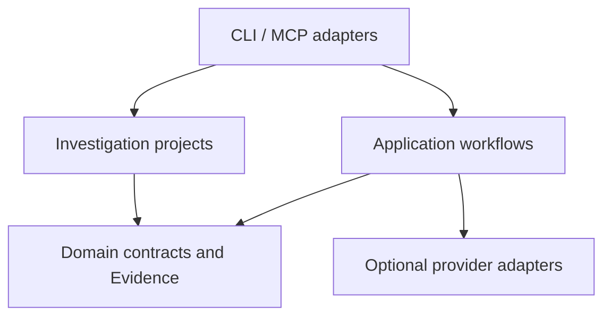

# AI Reverse Engineering

Local CLI and MCP platform for binary analysis, decompilation, program
understanding, and evidence-backed investigation.

This repository is an **independent fork and extension** of
[REA (Reverse Engineer Anything)](https://github.com/morluto/rea). It keeps
REA's local analysis tools and adds a persistent investigation-project
workflow. It is **not** the official `rea-agents` npm package and **not** the
[rea.tools](https://rea.tools) website.

Inspect software you own or are authorized to examine. Analysis stays on your
machine unless you explicitly enable an AI provider.

[](https://github.com/niravcse006/ai-reverse-engineering)
[](LICENSE)
[](docs/installation.md)
[](docs/mcp-contracts.md#generated-catalog)

**Current status: READY FOR PUBLIC GITHUB SOURCE.** Not ready for npm
publication, beta packaging, or production use. See
[release readiness](docs/RELEASE_READINESS.md).

[Installation](#installation) · [Investigation projects](#investigation-project-workflow) · [CLI](#cli-usage) · [MCP](#mcp-server) · [Testing](#testing) · [Limitations](#known-limitations) · [Contributing](#contributing)

## Purpose

Use one local toolchain to:

- inspect binaries, applications, firmware, and captured web artifacts
- keep Evidence identifiers, limitations, and unknowns attached to results
- persist an investigation project with targets, jobs, and reports
- optionally attach AI notes without sending the raw binary

The project layer hashes and classifies a target. It does not execute that
target and does not launch Ghidra, Hopper, IDA, or Frida.

## Relationship to upstream REA

| Item                   | Value                                                 |
| ---------------------- | ----------------------------------------------------- |
| Upstream               | https://github.com/morluto/rea                        |
| Compatible release     | rea-agents 6.8.0, tag `160d821`                       |
| Imported snapshot      | `17ceb77ca5f2632faab8de01da4babff680eac48`            |
| Latest compared `main` | `317bf3fe235e655b2d752d3be261cc0da7d00f2b` (ahead 40) |

CLI, MCP, Evidence, and provider adapters come from that snapshot plus selected
later ports. Investigation projects, reports, and remaining-command findings are
fork-only. Feature-by-feature status lives in
[docs/UPSTREAM_PARITY.md](docs/UPSTREAM_PARITY.md).

Do not treat an upstream capability as supported here unless this tree
implements and tests it.

## Key features

| Feature                                                           | Status                                                                                                                           |
| ----------------------------------------------------------------- | -------------------------------------------------------------------------------------------------------------------------------- |
| CLI inspect / analyze / decompile                                 | Implemented, not fully retested as a family this increment                                                                       |
| MCP stdio server and tool catalog                                 | Implemented; latest full unsandboxed suite exit 1 (5 load timeouts). Those cases passed focused. Prior JSON-cancel defect passed |
| Investigation projects and reports                                | Implemented and tested                                                                                                           |
| Format detection and streaming SHA-256                            | Implemented and tested                                                                                                           |
| Next recommended commands (named only)                            | Implemented and tested                                                                                                           |
| Optional AI notes (`REA_AI_*`)                                    | Implemented; local HTTP verified, external providers not verified                                                                |
| Ghidra / Hopper / IDA / Kuna / JADX / Frida                       | Implemented when the operator installs them; live lanes not claimed here                                                         |
| Guidance search, Mach-O slice encryption, environment write views | Planned / missing vs current upstream `main`                                                                                     |
| angr symbolic execution                                           | Unsupported                                                                                                                      |
| Plugin JavaScript loading                                         | Unsupported; metadata validation only                                                                                            |

## Architecture



Dependencies flow inward. Domain code does not launch engines or call the
network. See [architecture](docs/ARCHITECTURE.md) and
[docs/architecture.mermaid](docs/architecture.mermaid).

Investigation-project modules:

- `src/domain/investigationProject.ts`, `formatRegistry.ts`, `pluginContract.ts`, `aiProviderContract.ts`, `investigationReport.ts`
- `src/application/investigationProject/` (`ProjectStore`, `BackendProbe`, `AiProvider`, `Workflow`, `ReportWriter`)
- `src/cli/investigationProjectCommands.ts`

## Supported formats and providers

Built-in readers work without a deep engine. Deep decompilation needs a
bring-your-own provider.

| Target                 | Typical commands                                    | Prerequisite                               | Status                                               |
| ---------------------- | --------------------------------------------------- | ------------------------------------------ | ---------------------------------------------------- |
| ELF, PE, Mach-O        | `inspect`, `analyze`, `decompile`, `inspect-target` | Hopper, Ghidra, IDA, or Kuna for deep work | Implemented; live decompilers optional               |
| JavaScript / Electron  | `analyze-javascript-application`                    | None for static work                       | Implemented                                          |
| .NET assemblies        | `inspect-managed-artifact`                          | None for static metadata                   | Implemented; single-file bundles missing vs upstream |
| Android APK / DEX      | `inspect-android-package`                           | JADX / Apktool optional                    | Implemented                                          |
| Firmware, WASM, models | matching `inspect-*`                                | Built-in or caller tools                   | Implemented                                          |
| Web pages and HAR/SAZ  | `inspect-web-page`                                  | Browser optional                           | Implemented                                          |
| Process / Frida / GDB  | dedicated commands                                  | Explicit opt-in                            | Implemented; not part of `analyze-project`           |

`node scripts/rea.mjs doctor` and `providers` report what is installed.

## Installation

Requires Node.js `^22.23.4 || ^24.22.1 || >=26.12.1` and npm.

```bash
git clone https://github.com/niravcse006/ai-reverse-engineering.git
cd ai-reverse-engineering
npm ci
npm run build:cached
node scripts/rea.mjs --help
```

Optional local command (this tree still ships the `rea` / `rea-agents` binaries;
do not publish them to npm):

```bash
npm install --global .
rea doctor
```

More detail: [installation](docs/installation.md), [configuration](docs/CONFIGURATION.md).

## Development setup

```bash
nvm use          # .nvmrc is 24.22.1; 22.23.4 also matches engines
npm ci
npm run check:fast
npm run test:local -- src/application/investigationProject/Workflow.test.ts
```

Use `.nvmrc` and `package.json#packageManager`. See [CONTRIBUTING.md](CONTRIBUTING.md).

## CLI usage

```bash
node scripts/rea.mjs doctor
node scripts/rea.mjs providers
node scripts/rea.mjs inspect /absolute/path/to/binary --json
node scripts/rea.mjs inspect-macho /usr/bin/true --json
```

One-shot inspect/analyze/decompile still require a configured deep provider for
native decompilation.

## MCP server

Stdio is the intended local transport:

```bash
node scripts/rea.mjs setup
node scripts/rea.mjs mcp
```

`setup` shows planned file writes and requires approval. It configures
[supported agents](docs/installation.md#supported-agents); other clients can
use [manual MCP registration](docs/installation.md#mcp-registry). HTTP listen
refuses `0.0.0.0` unless you set `--allowed-hosts` / `MCP_ALLOWED_HOSTS`. Do
not bind an unauthenticated public interface.

Investigation-project commands are **CLI-only**. They are not MCP tools.

The [generated catalog](docs/mcp-contracts.md#generated-catalog) lists MCP
tools, providers, and CLI commands. Contracts: [mcp-contracts.md](docs/mcp-contracts.md).

## Investigation-project workflow

Create a project, import a file you may inspect, then produce a report. The
target is hashed and classified. It is not executed.

```bash
node scripts/rea.mjs init-project /absolute/path/to/project --name demo --json
node scripts/rea.mjs import-target /absolute/path/to/target --project /absolute/path/to/project --json
node scripts/rea.mjs inspect-target /absolute/path/to/target --project /absolute/path/to/project --json
node scripts/rea.mjs analyze-project --project /absolute/path/to/project --target tgt_... --json
node scripts/rea.mjs generate-report --project /absolute/path/to/project --job job_... --json
node scripts/rea.mjs project-status --project /absolute/path/to/project --json
```

| Step          | Command           | What happens                                                      |
| ------------- | ----------------- | ----------------------------------------------------------------- |
| 1. Initialize | `init-project`    | `project.json`, `targets/`, `jobs/`, `reports/`, `plugins/`       |
| 2. Import     | `import-target`   | Streaming SHA-256 and format; empty files refused                 |
| 3–5. Inspect  | `inspect-target`  | Hash, format, backend availability; no job                        |
| 6–12. Analyze | `analyze-project` | Static workflow, findings, evidence files, next commands, reports |
| Status        | `project-status`  | Targets, readable jobs, **unreadable job files**, backends, AI    |

`--authorize-dynamic` only records later authorization. It does not launch the
target. Plugin files are validated as metadata; this tree does not load plugin
code.

Findings keep confidence labels **observed**, **derived**, and **inferred**.
AI text is inferred. Next commands are named; they are not executed.

Walkthrough: [examples/investigation-project](examples/investigation-project/README.md).
Details: [investigation projects](docs/INVESTIGATION_PROJECTS.md).

## AI provider configuration

Disabled by default:

```text
REA_AI_PROVIDER=none
```

To attach evidence-scoped notes, copy [`.env.example`](.env.example) and set
`REA_AI_PROVIDER`, `REA_AI_ENDPOINT`, and `REA_AI_MODEL`. Put `REA_AI_API_KEY`
in the environment, not in git. `REA_AI_SPENDING_LIMIT_USD=0` refuses before
fetch.

Outbound data is findings JSON plus prompts, not the raw binary. The key is
sent only in the `Authorization` header. External providers have not been
verified in this repository.

See [AI providers](docs/AI_PROVIDERS.md) and [privacy](docs/PRIVACY.md).

## Testing

```bash
npm run check:fast
npm run test:local -- src/application/investigationProject/Workflow.test.ts
npm run test:mcp
npm run docs:check
npm run upstream:drift
```

`test:mcp` needs an unrestricted environment (process spawn). Real Ghidra, IDA,
Hopper, JADX, and Frida lanes need those tools. Latest recorded results:
[docs/FINAL_AUDIT.md](docs/FINAL_AUDIT.md) and [docs/testing.md](docs/testing.md).

## Security and privacy

- Investigation import and analyze never execute the target.
- Job and finding ids must match `^[A-Za-z0-9_]+$`.
- Evidence JSON is written mode `0600` under the project root.
- AI is optional and disclosed.
- Publishing this tree as npm `rea-agents` would impersonate upstream. Do not
  publish until an independent identity is chosen.

Report vulnerabilities through [SECURITY.md](SECURITY.md). This is not a
security certification.

## Known limitations

- Package and MCP identities are still `rea-agents` / `io.github.morluto/rea`.
- Full `npm test` and `check:pr` have not been completed on this fork as a
  release gate. Latest `npm run test:mcp` still exits 1 under load.
- Current upstream `main` is still ahead on several artifact families
  (environment write views, Mach-O encryption, .NET single-file bundles,
  JS operator-influence traces, symlink-target bytes). `rea guidance` and
  MCP `search_guidance` / `read_guidance_section` are implemented here.
- Investigation commands are CLI-only.
- Live commercial engines and external AI providers are not claimed as verified.

## Roadmap

1. Independent package and MCP identity after owner approval.
2. Quiet-machine full MCP re-run and `check:pr`.
3. Incremental ports of security-adjacent upstream fixes.
4. Packed-tarball install verification.

See [docs/roadmap.md](docs/roadmap.md) and [docs/RELEASE_READINESS.md](docs/RELEASE_READINESS.md).

## Contributing

Read [CONTRIBUTING.md](CONTRIBUTING.md). Prefer focused fixes with evidence.
Do not load plugin JavaScript. Do not execute unknown binaries from
`inspect-target` or `analyze-project`.

Issues: https://github.com/niravcse006/ai-reverse-engineering/issues

## License and attribution

[MIT](LICENSE). Copyright 2026 morluto and niravcse006.

CLI, MCP, Evidence, and provider workflows come from the
[REA 6.8.0](https://github.com/morluto/rea) snapshot
`17ceb77ca5f2632faab8de01da4babff680eac48`. This repository is not the official
`rea-agents` publication. See [license and attribution](docs/LICENSE_AND_ATTRIBUTION.md)
and [third-party notices](THIRD_PARTY_NOTICES.md).
